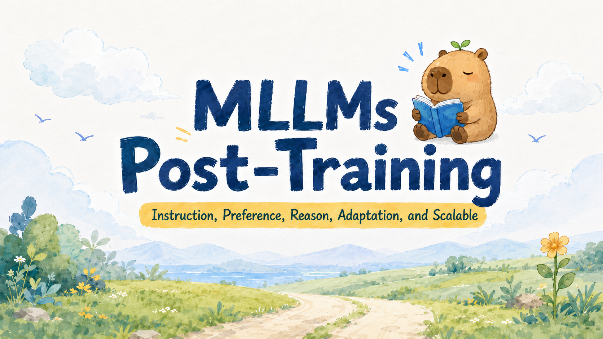
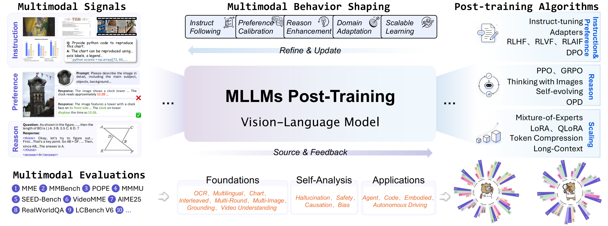
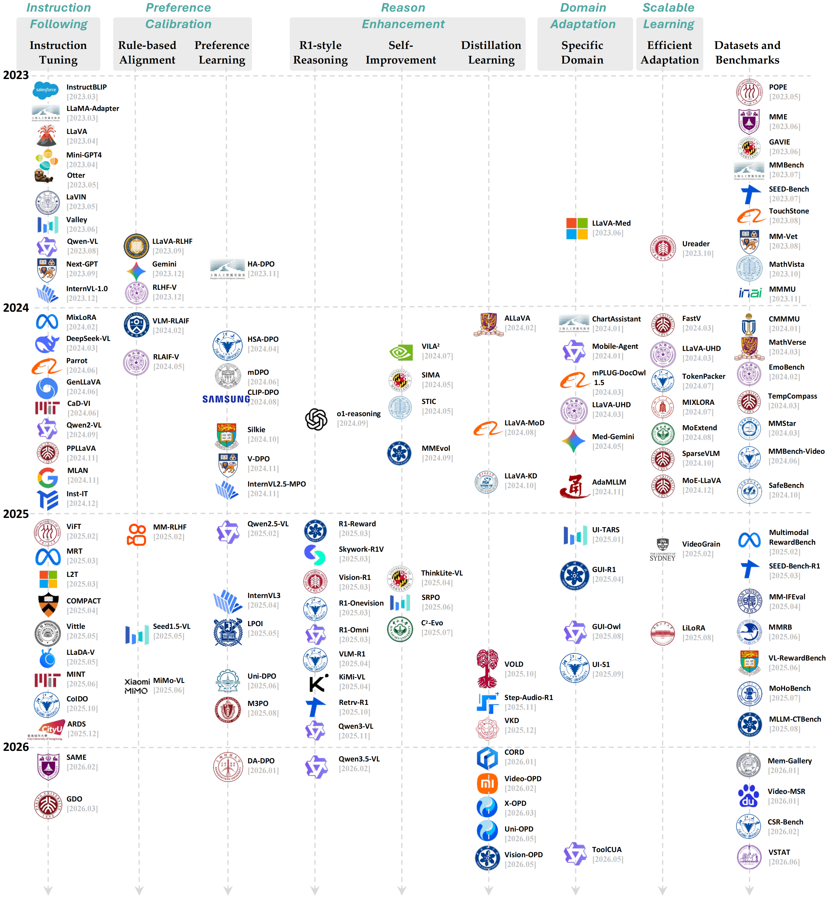

<div align="center">



# Awesome Post-Training for MLLMs

A curated reading list accompanying **A Survey on Post-Training of Multimodal Large Language Models**.

[](https://zchoi.github.io/MMPoT-Survey/preprint.pdf)
[](https://zchoi.github.io/MMPoT-Survey/)
[](LICENSE)

[Browse papers](#contents) · [Benchmarks](#multimodal-benchmarks) · [Project website](https://zchoi.github.io/MMPoT-Survey/) · [Contributors](#contributors) · [Citation](#citation)

Watch this repository for updates. Contributions and paper suggestions are welcome!

</div>

## Introduction

Multimodal Large Language Models (MLLMs) have reshaped AI by enabling perception, reasoning, and interaction across digital and physical environments. While multimodal pretraining establishes broad perceptual capabilities, translating them into behaviors aligned with human intent and real-world demands remains challenging. Multimodal Post-Training (MMPoT) addresses this gap by refining pretrained MLLMs toward reliable, task-oriented behavior. This survey reviews MMPoT from a behavior-shaping perspective and organizes existing methods into five families: instruction following, preference calibration, reasoning enhancement, domain adaptation, and scalable training. We further examine benchmarks and evaluation protocols, identify current limitations, and outline future directions toward general and reliable multimodal intelligence.

## Contents

| Research area | Browse by topic |
| :--- | :--- |
| [Instruction tuning](#multimodal-instruction-tuning) | Multimodal instruction following and visual prompting |
| [Preference calibration](#multimodal-preference-calibration) | [RLHF](#multimodal-rlhf) · [RLAIF](#multimodal-rlaif) · [Direct preference optimization](#multimodal-direct-preference-optimization) |
| [Reasoning enhancement](#multimodal-reasoning-enhancement) | [R1-style reasoning](#r1-based-multimodal-reasoning) · [Thinking with images](#thinking-with-images)<br>[Self-evolving](#multimodal-self-evolving) · [Distillation](#multimodal-distillation) |
| [Domain adaptation](#multimodal-domain-adaptation) | Post-training for specialized multimodal scenarios |
| [Scalable training](#multimodal-scalable-training) | [LoRA](#lora-based-methods) · [MoE](#moe-based-methods) · [Compute-efficient methods](#compute-efficient-methods)<br>[Visual processing](#efficient-visual-processing-evp) · [Token compression](#token-compression-tc) · [Long context](#long-context-optimization-lco) |
| [Benchmarks](#multimodal-benchmarks) | [Instruction tuning](#instruction-tuning-benchmarks) · [Alignment](#alignment-learning-benchmarks)<br>[Reasoning](#reasoning-enhancement-benchmarks) · [Domain adaptation](#domain-adaptation-benchmarks) |

**Reading the list.** Each paper has one full entry with its affiliation and resources. An **↗** entry links to that record when the paper is relevant to another category; benchmark-specific datasets and code remain alongside the reference. Venue labels distinguish conference papers, workshops, journals, and preprints.

## News

- **2026-10-09** — 🎉 We expand our collection with four new papers: **VidGround**, **FusionAgent**, **DepthAgent**, and **Spatial-Interactor**. Thanks to our community contributors!
- **2026-07-22** — 🎉 Our survey paper and project page are now available!
- **2026-07-19** — 🎉 We launch our curated list of MLLM post-training methods!

<details>
<summary><strong>Research framework and timeline</strong></summary>

<p align="center">
  
  <span><b>Figure 1. Overview of multimodal behavior shaping for MLLMs post-training.</b> Post-training algorithms can be viewed as behavior-shaping mechanisms that steer pretrained MLLMs toward desired behaviors, while multimodal data and benchmarks provide learning signals and evaluative feedback for iterative refinement.</span>
</p>

<p align="center">
  
  <span><b>Figure 2. A timeline of MLLMs post-training research.</b></span>
</p>

</details>

---

## Multimodal Instruction Tuning

| Paper / affiliation | Venue | Resources |
| :--- | :--- | :--- |
| <a id="paper-2304-08485"></a>**Visual Instruction Tuning**<br><sub>University of Wisconsin–Madison, Microsoft Research, Columbia University</sub> | NeurIPS 2023 | [Paper](https://arxiv.org/pdf/2304.08485) · [Code](https://github.com/haotian-liu/LLaVA) · [Project](https://llava-vl.github.io/) |
| <a id="paper-2304-10592"></a>**MiniGPT-4: Enhancing Vision-Language Understanding with Advanced Large Language Models**<br><sub>King Abdullah University of Science and Technology</sub> | ICLR 2024 | [Paper](https://arxiv.org/pdf/2304.10592) · [Code](https://github.com/Vision-CAIR/MiniGPT-4) · [Project](https://minigpt-4.github.io/) |
| <a id="paper-2305-06500"></a>**InstructBLIP: Towards General-purpose Vision-Language Models with Instruction Tuning**<br><sub>Salesforce Research, Hong Kong University of Science and Technology, Nanyang Technological University, Singapore</sub> | NeurIPS 2023 | [Paper](https://arxiv.org/pdf/2305.06500) · [Code](https://github.com/salesforce/LAVIS/tree/main/projects/instructblip) |
| <a id="paper-2304-14178"></a>**mPLUG-Owl: Modularization Empowers Large Language Models with Multimodality**<br><sub>DAMO Academy, Alibaba Group</sub> | arXiv 2023 | [Paper](https://arxiv.org/pdf/2304.14178) · [Code](https://github.com/X-PLUG/mPLUG-Owl) |
| <a id="paper-2304-15010"></a>**LLaMA-Adapter V2: Parameter-Efficient Visual Instruction Model**<br><sub>Shanghai Artificial Intelligence Laboratory, CUHK MMLab, Rutgers University</sub> | arXiv 2023 | [Paper](https://arxiv.org/pdf/2304.15010) · [Code](https://github.com/OpenGVLab/LLaMA-Adapter) |
| <a id="paper-2310-03744"></a>**Improved Baselines with Visual Instruction Tuning**<br><sub>University of Wisconsin–Madison, Microsoft Research, Redmond</sub> | CVPR 2024 | [Paper](https://arxiv.org/pdf/2310.03744) · [Code](https://github.com/haotian-liu/LLaVA) · [Project](https://llava-vl.github.io/) |
| <a id="paper-2308-12966"></a>**Qwen-VL: A Versatile Vision-Language Model for Understanding, Localization, Text Reading, and Beyond**<br><sub>Alibaba Group</sub> | arXiv 2023 | [Paper](https://arxiv.org/pdf/2308.12966) · [Code](https://github.com/QwenLM/Qwen-VL) |
| <a id="paper-2311-03079"></a>**CogVLM: Visual Expert for Pretrained Language Models**<br><sub>Tsinghua University, Zhipu AI</sub> | NeurIPS 2024 | [Paper](https://arxiv.org/pdf/2311.03079) · [Code](https://github.com/THUDM/CogVLM) |
| <a id="paper-2312-14238"></a>**InternVL: Scaling up Vision Foundation Models and Aligning for Generic Visual-Linguistic Tasks**<br><sub>OpenGVLab, Shanghai AI Laboratory, Nanjing University, The University of Hong Kong, The Chinese University of Hong Kong, Tsinghua University, University of Science and Technology of China, SenseTime Research</sub> | CVPR 2024 | [Paper](https://arxiv.org/pdf/2312.14238) · [Code](https://github.com/OpenGVLab/InternVL) |
| <a id="paper-llava-next-improved-reasoning-ocr-and-world-knowledge"></a>**LLaVA-NeXT: Improved Reasoning, OCR, and World Knowledge**<br><sub>University of Wisconsin-Madison, Microsoft Research</sub> | arXiv 2024 | [Paper](https://llava-vl.github.io/blog/2024-01-30-llava-next/) · [Code](https://github.com/LLaVA-VL/LLaVA-NeXT) · [Project](https://llava-vl.github.io/blog/2024-01-30-llava-next/) |
| <a id="paper-2405-02246"></a>**What matters when building vision-language models?**<br><sub>Hugging Face, Sorbonne Université</sub> | NeurIPS 2024 | [Paper](https://arxiv.org/pdf/2405.02246) · [Hugging Face](https://huggingface.co/HuggingFaceM4/idefics2-8b) |
| <a id="paper-2409-12191"></a>**Qwen2-VL: Enhancing Vision-Language Model's Perception of the World at Any Resolution**<br><sub>Qwen Team, Alibaba Group</sub> | arXiv 2024 | [Paper](https://arxiv.org/pdf/2409.12191) · [Code](https://github.com/QwenLM/Qwen2-VL) |
| <a id="paper-2408-03326"></a>**LLaVA-OneVision: Easy Visual Task Transfer**<br><sub>ByteDance, S-Lab, NTU, CUHK, HKUST</sub> | TMLR 2025 | [Paper](https://arxiv.org/pdf/2408.03326) · [Code](https://github.com/LLaVA-VL/LLaVA-NeXT/blob/main/docs/LLaVA_OneVision.md) · [Project](https://llava-vl.github.io/blog/2024-08-05-llava-onevision/) |
| <a id="paper-2412-05271"></a>**Expanding Performance Boundaries of Open-Source Multimodal Models with Model, Data, and Test-Time Scaling**<br><sub>Shanghai AI Laboratory, SenseTime Research, Tsinghua University, Nanjing University, Fudan University, The Chinese University of Hong Kong, Shanghai Jiao Tong University</sub> | arXiv 2024 | [Paper](https://arxiv.org/pdf/2412.05271) · [Code](https://github.com/OpenGVLab/InternVL) · [Project](https://internvl.github.io/blog/2024-12-05-InternVL-2.5/) |
| <a id="paper-2502-13923"></a>**Qwen2.5-VL Technical Report**<br><sub>Alibaba Group</sub> | arXiv 2025 | [Paper](https://arxiv.org/pdf/2502.13923) · [Code](https://github.com/QwenLM/Qwen2.5-VL) |
| <a id="paper-2312-07533"></a>**VILA: On Pre-training for Visual Language Models**<br><sub>NVIDIA, MIT</sub> | CVPR 2024 | [Paper](https://arxiv.org/pdf/2312.07533) · [Code](https://github.com/NVlabs/VILA) |
| <a id="paper-2312-16886"></a>**MobileVLM : A Fast, Strong and Open Vision Language Assistant for Mobile Devices**<br><sub>Meituan Inc., Zhejiang University, China, Dalian University of Technology, China</sub> | arXiv 2023 | [Paper](https://arxiv.org/pdf/2312.16886) · [Code](https://github.com/Meituan-AutoML/MobileVLM) |
| <a id="paper-2403-05525"></a>**DeepSeek-VL: Towards Real-World Vision-Language Understanding**<br><sub>DeepSeek-AI</sub> | arXiv 2024 | [Paper](https://arxiv.org/pdf/2403.05525) · [Code](https://github.com/deepseek-ai/DeepSeek-VL) |
| <a id="paper-2403-04652"></a>**Yi: Open Foundation Models by 01.AI**<br><sub>01.AI</sub> | arXiv 2024 | [Paper](https://arxiv.org/pdf/2403.04652) · [Code](https://github.com/01-ai/Yi) · [Hugging Face](https://huggingface.co/01-ai/Yi-VL-6B) |
| <a id="paper-2406-16860"></a>**Cambrian-1: A Fully Open, Vision-Centric Exploration of Multimodal LLMs**<br><sub>New York University</sub> | NeurIPS 2024 | [Paper](https://arxiv.org/pdf/2406.16860) · [Code](https://github.com/cambrian-mllm/cambrian) · [Project](https://cambrian-mllm.github.io/) |
| <a id="paper-2408-01800"></a>**MiniCPM-V: A GPT-4V Level MLLM on Your Phone**<br><sub>OpenBMB</sub> | arXiv 2024 | [Paper](https://arxiv.org/pdf/2408.01800) · [Code](https://github.com/OpenBMB/MiniCPM-V) · [Project](https://huggingface.co/openbmb/MiniCPM-V-2_6) |
| <a id="paper-2404-14219"></a>**Phi-3 Technical Report: A Highly Capable Language Model Locally on Your Phone**<br><sub>Microsoft</sub> | arXiv 2024 | [Paper](https://arxiv.org/pdf/2404.14219) · [Hugging Face](https://huggingface.co/microsoft/Phi-3.5-vision-instruct) |
| <a id="paper-2407-21783"></a>**The Llama 3 Herd of Models**<br><sub>Meta</sub> | arXiv 2024 | [Paper](https://arxiv.org/abs/2407.21783) · [Hugging Face](https://huggingface.co/meta-llama/Llama-3.2-11B-Vision-Instruct) · [Project](https://www.llama.com/) |
| <a id="paper-2409-17146"></a>**Molmo and PixMo: Open Weights and Open Data for State-of-the-Art Vision-Language Models**<br><sub>Allen Institute for AI, University of Washington</sub> | CVPR 2025 | [Paper](https://arxiv.org/pdf/2409.17146) · [Code](https://github.com/allenai/molmo) · [Project](https://molmo.allenai.org/) |
| <a id="paper-2410-07073"></a>**Pixtral-12B**<br><sub>Mistral AI</sub> | arXiv 2024 | [Paper](https://arxiv.org/pdf/2410.07073) · [Hugging Face](https://huggingface.co/mistralai/Pixtral-12B-2409) · [Project](https://mistral.ai/news/pixtral-12b) |
| <a id="paper-2406-09240"></a>**Comparison Visual Instruction Tuning**<br><sub>ELLIS Unit, LIT AI Lab, Institute for Machine Learning, JKU Linz, Austria, TU Graz ICG, Austria, IBM Research, Israel, Weizmann Institute of Science, Israel, Tel-Aviv University, Israel, NXAI GmbH, Austria, MIT-IBM Watson AI Lab, USA</sub> | CVPR 2025 Workshop | [Paper](https://arxiv.org/pdf/2406.09240) · [Code](https://github.com/wlin-at/CaD-VI) · [Project](https://wlin-at.github.io/cad_vi) · [Hugging Face](https://huggingface.co/datasets/wlin21at/CaD-Inst) |
| <a id="paper-2407-07726"></a>**PaliGemma: A versatile 3B VLM for transfer**<br><sub>Google DeepMind</sub> | arXiv 2024 | [Paper](https://arxiv.org/pdf/2407.07726) · [Hugging Face](https://huggingface.co/google/paligemma-3b-mix-224) |
| <a id="paper-2305-03726"></a>**Otter: A Multi-Modal Model with In-Context Instruction Tuning**<br><sub>S-Lab, Nanyang Technological University, Microsoft Research</sub> | TPAMI 2025 | [Paper](https://arxiv.org/pdf/2305.03726) · [Code](https://github.com/Luodian/Otter) |
| <a id="paper-2303-16199"></a>**LLaMA-Adapter: Efficient Fine-tuning of Language Models with Zero-init Attention**<br><sub>Shanghai Artificial Intelligence Laboratory, CUHK MMLab, University of California, Los Angeles, CPII of InnoHK</sub> | ICLR 2024 | [Paper](https://arxiv.org/pdf/2303.16199) · [Code](https://github.com/OpenGVLab/LLaMA-Adapter) |
| <a id="paper-2305-15023"></a>**Cheap and Quick: Efficient Vision-Language Instruction Tuning for Large Language Models**<br><sub>Key Laboratory of Multimedia Trusted Perception and Efficient Computing, Ministry of Education of China, School of Informatics, Xiamen University, 361005, P.R. China., Institute of Artificial Intelligence, Xiamen University, 361005, P.R. China., Peng Cheng Laboratory, Shenzhen, 518000, China.</sub> | NeurIPS 2023 | [Paper](https://arxiv.org/pdf/2305.15023) · [Code](https://github.com/luogen1996/LaVIN) |
| <a id="paper-2306-07207"></a>**Valley: Video Assistant with Large Language model Enhanced abilitY**<br><sub>ByteDance Inc., Fudan University, East China Normal University</sub> | arXiv 2023 | [Paper](https://arxiv.org/pdf/2306.07207) · [Code](https://github.com/RupertLuo/Valley) |
| <a id="paper-2309-05519"></a>**NExT-GPT: Any-to-Any Multimodal LLM**<br><sub>National University of Singapore</sub> | ICML 2024 | [Paper](https://arxiv.org/pdf/2309.05519) · [Code](https://github.com/NExT-GPT/NExT-GPT) · [Project](https://next-gpt.github.io/) |
| <a id="paper-2406-11262"></a>**Generative Visual Instruction Tuning**<br><sub>Rice University, Google DeepMind</sub> | arXiv 2024 | [Paper](https://arxiv.org/pdf/2406.11262) · [Code](https://github.com/jeffhernandez1995/GenLlaVA) |
| <a id="paper-2411-10557"></a>**MLAN: Language-Based Instruction Tuning Preserves and Transfers Knowledge in Multimodal Language Models**<br><sub>Washington University in St. Louis, The University of British Columbia, Google Research, Virginia Tech, University of California, Davis, Sony AI, University of California, Berkeley</sub> | arXiv 2024 | [Paper](https://arxiv.org/pdf/2411.10557) |
| <a id="paper-2412-03565"></a>**INST-IT: Boosting Instance Understanding via Explicit Visual Prompt Instruction Tuning**<br><sub>Institute of Trustworthy Embodied AI, Fudan University, Shanghai Innovation Institute, Huawei Noah, s Ark Lab</sub> | NeurIPS 2025 | [Paper](https://arxiv.org/pdf/2412.03565) · [Code](https://github.com/inst-it/inst-it) · [Project](https://inst-it.github.io/) |
| <a id="paper-2503-22215"></a>**Learning to Instruct for Visual Instruction Tuning**<br><sub>Cooperative Medianet Innovation Center, Shanghai Jiao Tong University, Microsoft Research Asia, Hong Kong Baptist University, School of Artificial Intelligence, Shanghai Jiao Tong University</sub> | NeurIPS 2025 | [Paper](https://arxiv.org/pdf/2503.22215) · [Code](https://github.com/Feng-Hong/L2T) |
| <a id="paper-2504-21850"></a>**Visual Compositional Tuning**<br><sub>Princeton University, Meta AI</sub> | ICLR 2026 Workshop | [Paper](https://arxiv.org/pdf/2504.21850) · [Code](https://github.com/princetonvisualai/compact) · [Project](https://princetonvisualai.github.io/compact/) |
| <a id="paper-2505-13946"></a>**Visual Instruction Bottleneck Tuning**<br><sub>Department of Computer Sciences, University of Wisconsin–Madison</sub> | NeurIPS 2025 | [Paper](https://arxiv.org/pdf/2505.13946) · [Code](https://github.com/deeplearning-wisc/vittle) |
| <a id="paper-2505-16933"></a>**LLaDA-V: Large Language Diffusion Models with Visual Instruction Tuning**<br><sub>Gaoling School of AI, Renmin University of China, Beijing Key Laboratory of Research on Large Models and Intelligent Governance, Engineering Research Center of Next-Generation Intelligent Search and Recommendation, MOE, Ant Group</sub> | arXiv 2025 | [Paper](https://arxiv.org/pdf/2505.16933) · [Code](https://ml-gsai.github.io/LLaDA-V-demo/) · [Project](https://ml-gsai.github.io/LLaDA-V-demo/) |
| <a id="paper-2603-12478"></a>**Less Data, Faster Convergence: Goal-Driven Data Optimization for Multimodal Instruction Tuning**<br><sub>Peking University, University of Illinois at Urbana-Champaign, National University of Singapore</sub> | ECCV 2026 | [Paper](https://arxiv.org/pdf/2603.12478) · [Code](https://github.com/rujiewu/GDO) |
| <a id="paper-2407-07895"></a>**LLaVA-NeXT-Interleave: Tackling Multi-image, Video, and 3D in Large Multimodal Models**<br><sub>ByteDance, HKUST, CUHK, NTU</sub> | ICLR 2025 | [Paper](https://arxiv.org/pdf/2407.07895) · [Code](https://github.com/LLaVA-VL/LLaVA-NeXT) · [Project](https://llava-vl.github.io/blog/2024-06-16-llava-next-interleave/) |
| <a id="paper-2407-08739"></a>**MAVIS: Mathematical Visual Instruction Tuning with an Automatic Data Engine**<br><sub>CUHK, Peking University, Shanghai AI Laboratory, ByteDance, Oracle</sub> | ICLR 2025 | [Paper](https://arxiv.org/pdf/2407.08739) · [Code](https://github.com/ZrrSkywalker/MAVIS) |
| <a id="paper-2405-01483"></a>**MANTIS: Interleaved Multi-Image Instruction Tuning**<br><sub>University of Waterloo, Tsinghua University, Sea AI Lab</sub> | TMLR 2024 | [Paper](https://arxiv.org/pdf/2405.01483) · [Code](https://github.com/OpenGVLab/LLaMA-Adapter/tree/main/imagebind_LLM) · [Project](https://tiger-ai-lab.github.io/Mantis/) |
| <a id="paper-2309-03905"></a>**ImageBind-LLM: Multi-modality Instruction Tuning**<br><sub>Shanghai Artificial Intelligence Laboratory, Shanghai, 200030, China., CUHK MMLab, Hong Kong SAR, 999077, China., vivo AI Lab, Shenzhen, 518000, China.</sub> | arXiv 2023 | [Paper](https://arxiv.org/pdf/2309.03905) · [Code](https://github.com/OpenGVLab/LLaMA-Adapter/tree/main/imagebind_LLM) |
| <a id="paper-2311-12793"></a>**ShareGPT4V: Improving Large Multi-Modal Models with Better Captions**<br><sub>University of Science and Technology of China, Shanghai AI Laboratory</sub> | ECCV 2024 | [Paper](https://arxiv.org/pdf/2311.12793) · [Code](https://github.com/ShareGPT4Omni/ShareGPT4V) · [Project](https://sharegpt4v.github.io/) |
| <a id="paper-2310-09478"></a>**MiniGPT-v2: large language model as a unified interface for vision-language multi-task learning**<br><sub>King Abdullah University of Science and Technology (KAUST), Meta AI Research</sub> | arXiv 2023 | [Paper](https://arxiv.org/pdf/2310.09478) · [Code](https://github.com/Vision-CAIR/MiniGPT-4) · [Project](https://minigpt-v2.github.io/) |
| <a id="paper-2312-00784"></a>**ViP-LLaVA: Making Large Multimodal Models Understand Arbitrary Visual Prompts**<br><sub>University of Wisconsin–Madison；Cruise LLC</sub> | CVPR 2024 | [Paper](https://arxiv.org/pdf/2312.00784) · [Code](https://github.com/WisconsinAIVision/ViP-LLaVA) · [Project](https://vip-llava.github.io/) |
| <a id="paper-2403-07508"></a>**MoAI: Mixture of All Intelligence for Large Language and Vision Models**<br><sub>School of Electrical Engineering Korea Advanced Institute of Science and Technology (KAIST)</sub> | ECCV 2024 | [Paper](https://arxiv.org/pdf/2403.07508) · [Code](https://github.com/ByungKwanLee/MoAI) |
| <a id="paper-2311-06607"></a>**Monkey: Image Resolution and Text Label Are Important Things for Large Multi-modal Models**<br><sub>Huazhong University of Science and Technology, Kingsoft Office</sub> | CVPR 2024 | [Paper](https://arxiv.org/pdf/2311.06607) · [Code](https://github.com/Yuliang-Liu/Monkey) |
| <a id="paper-2403-18814"></a>**Mini-Gemini: Mining the Potential of Multi-modality Vision Language Models**<br><sub>The Chinese University of Hong Kong；SmartMore</sub> | TPAMI 2026 | [Paper](https://arxiv.org/pdf/2403.18814v1) · [Code](https://github.com/JIA-Lab-research/MGM) |
| <a id="paper-2403-03003"></a>**Feast Your Eyes: Mixture-of-Resolution Adaptation for Multimodal Large Language Models**<br><sub>Xiamen University</sub> | ICLR 2025 | [Paper](https://arxiv.org/pdf/2403.03003) · [Code](https://github.com/luogen1996/LLaVA-HR) |
| <a id="paper-2311-07575"></a>**SPHINX: The Joint Mixing of Weights, Tasks, and Visual Embeddings for Multi-modal Large Language Models**<br><sub>Shanghai AI Laboratory；MMLab, CUHK；ShanghaiTech University</sub> | arXiv 2023 | [Paper](https://arxiv.org/pdf/2311.07575) · [Code](https://github.com/Alpha-VLLM/LLaMA2-Accessory) |

---

[Back to contents](#contents)

<a id="multimodal-alignment-learning"></a>

## Multimodal Preference Calibration

### Multimodal RLHF

| Paper / affiliation | Venue | Resources |
| :--- | :--- | :--- |
| <a id="paper-2309-14525"></a>**Aligning Large Multimodal Models with Factually Augmented RLHF**<br><sub>UC Berkeley, Carnegie Mellon University, University of Illinois Urbana-Champaign, University of Wisconsin-Madison, University of Massachusetts Amherst, Microsoft Research, MIT-IBM Watson AI Lab</sub> | ACL Findings 2024 | [Paper](https://arxiv.org/pdf/2309.14525) · [Code](https://github.com/llava-rlhf/LLaVA-RLHF) · [Project](https://llava-rlhf.github.io/) |
| <a id="paper-2312-00849"></a>**RLHF-V: Towards Trustworthy MLLMs via Behavior Alignment from Fine-grained Correctional Human Feedback**<br><sub>Tsinghua University, National University of Singapore</sub> | CVPR 2024 | [Paper](https://arxiv.org/pdf/2312.00849) · [Code](https://github.com/RLHF-V/RLHF-V) · [Project](https://rlhf-v.github.io/) |
| <a id="paper-mm-rlhf-the-next-step-forward-in-multimodal-llm-alignment"></a>**MM-RLHF: The Next Step Forward in Multimodal LLM Alignment**<br><sub>Institute of Automation, Chinese Academy of Sciences, Nanjing University, Kuaishou</sub> | ICML 2025 | [Paper](https://proceedings.mlr.press/v267/zhang25cs.html) · [Code](https://github.com/Kwai-YuanQi/MM-RLHF) · [Project](https://mm-rlhf.github.io/) |
| <a id="paper-r1-reward-training-multimodal-reward-model-through-stable-reinforcement-learning"></a>**R1-Reward: Training Multimodal Reward Model Through Stable Reinforcement Learning**<br><sub>Institute of Automation, Chinese Academy of Sciences, Tsinghua University, Nanjing University, Kuaishou</sub> | ICLR 2026 | [Paper](https://proceedings.iclr.cc/paper_files/paper/2026/file/3469a586c2e8ebdf59ee66381fd87454-Paper-Conference.pdf) · [Code](https://github.com/yfzhang114/r1_reward) |
| <a id="paper-2503-10291"></a>**VisualPRM: An Effective Process Reward Model for Multimodal Reasoning**<br><sub>Shanghai AI Laboratory, SenseTime Research, Zhejiang University</sub> | arXiv 2025 | [Paper](https://arxiv.org/pdf/2503.10291) · [Project](https://internvl.github.io/blog/2025-03-13-VisualPRM/) |
| <a id="paper-2312-11805"></a>**Gemini: A Family of Highly Capable Multimodal Models**<br><sub>Google</sub> | arXiv 2023 | [Paper](https://arxiv.org/pdf/2312.11805) · [Project](https://deepmind.google/technologies/gemini/) |
| <a id="paper-2505-07062"></a>**Seed1.5-VL Technical Report**<br><sub>ByteDance Seed</sub> | arXiv 2025 | [Paper](https://arxiv.org/pdf/2505.07062) · [Code](https://github.com/ByteDance-Seed/Seed1.5-VL) · [Project](https://seed.bytedance.com/en/tech/seed1_5_vl) |
| <a id="paper-2506-03569"></a>**MiMo-VL Technical Report**<br><sub>LLM-Core Xiaomi</sub> | arXiv 2025 | [Paper](https://arxiv.org/pdf/2506.03569) · [Code](https://github.com/XiaomiMiMo/MiMo-VL) |

### Multimodal RLAIF

| Paper / affiliation | Venue | Resources |
| :--- | :--- | :--- |
| <a id="paper-2402-03746"></a>**Tuning Large Multimodal Models for Videos using Reinforcement Learning from AI Feedback**<br><sub>Yonsei University, University of Minnesota, Seoul National University</sub> | ACL 2024 | [Paper](https://arxiv.org/pdf/2402.03746) · [Code](https://github.com/yonseivnl/vlm-rlaif) · [Project](https://dcahn12.github.io/projects/vlm-rlaif/) |
| <a id="paper-2405-17220"></a>**RLAIF-V: Open-Source AI Feedback Leads to Super GPT-4V Trustworthiness**<br><sub>Tsinghua University, Shanghai Qi Zhi Institute, Harbin Institute of Technology, Taobao &amp; Tmall Group of Alibaba, Peng Cheng Laboratory, National University of Singapore</sub> | CVPR 2025 | [Paper](https://arxiv.org/pdf/2405.17220) · [Code](https://github.com/RLHF-V/RLAIF-V) |
| <a id="paper-2510-02561"></a>**Oracle-RLAIF: An Improved Fine-Tuning Framework for Multi-modal Video Models using Reinforcement Learning from Ranking Feedback**<br><sub>Stanford University, xAI, Microsoft</sub> | arXiv 2025 | [Paper](https://arxiv.org/abs/2510.02561) |

### Multimodal Direct Preference Optimization

| Paper / affiliation | Venue | Resources |
| :--- | :--- | :--- |
| <a id="paper-2312-10665"></a>**Silkie: Preference Distillation for Large Visual Language Models**<br><sub>University of Hong Kong, The Chinese University of Hong Kong, Shenzhen, Peng Cheng Laboratory</sub> | arXiv 2023 | [Paper](https://arxiv.org/pdf/2312.10665) · [Code](https://github.com/vlf-silkie/VLFeedback) · [Project](https://vlf-silkie.github.io/) |
| <a id="paper-2404-01258"></a>**Direct Preference Optimization of Video Large Multimodal Models from Language Model Reward**<br><sub>CMULTI, Bytedance, UT Austin, Columbia University, NTU</sub> | NAACL 2025 | [Paper](https://arxiv.org/pdf/2404.01258) · [Code](https://github.com/RifleZhang/LLaVA-Hound-DPO) |
| <a id="paper-2406-11280"></a>**ISR-DPO: Aligning Large Multimodal Models for Videos by Iterative Self-Retrospective DPO**<br><sub>Seoul National University, Yonsei University, University of Minnesota</sub> | AAAI 2025 | [Paper](https://arxiv.org/pdf/2406.11280) · [Code](https://github.com/snumprlab/isr-dpo) · [Project](https://dcahn12.github.io/projects/isr-dpo/) |
| <a id="paper-2311-16839"></a>**Beyond Hallucinations: Enhancing LVLMs through Hallucination-Aware Direct Preference Optimization**<br><sub>Shanghai AI Laboratory</sub> | arXiv 2023 | [Paper](https://arxiv.org/pdf/2311.16839) · [Code](https://github.com/opendatalab/HA-DPO) · [Project](https://opendatalab.github.io/HA-DPO/) |
| <a id="paper-2411-10436"></a>**Mitigating Hallucination in Multimodal Large Language Model via Hallucination-targeted Direct Preference Optimization**<br><sub>Key Lab of DEKE, Renmin University of China, Machine Learning Platform Department, Tencent</sub> | arXiv 2024 | [Paper](https://arxiv.org/pdf/2411.10436) |
| <a id="paper-2411-02712"></a>**V-DPO: Mitigating Hallucination in Large Vision Language Models via Vision-Guided Direct Preference Optimization**<br><sub>National University of Singapore</sub> | EMNLP 2024 | [Paper](https://arxiv.org/pdf/2411.02712) · [Code](https://github.com/YuxiXie/V-DPO) |
| <a id="paper-2408-10433"></a>**CLIP-DPO: Vision-Language Models as a Source of Preference for Fixing Hallucinations in LVLMs**<br><sub>Samsung AI Center Cambridge, UK, Technical University of Iasi, Romania, Queen Mary University of London, UK</sub> | ECCV 2024 | [Paper](https://arxiv.org/pdf/2408.10433) |
| <a id="paper-2508-20181"></a>**Mitigating Hallucinations in Multimodal LLMs via Object-aware Preference Optimization**<br><sub>University of Modena and Reggio Emilia</sub> | BMVC 2025 | [Paper](https://arxiv.org/pdf/2508.20181) · [Code](https://github.com/aimagelab/CHAIR-DPO) |
| <a id="paper-2406-11839"></a>**MDPO: Conditional Preference Optimization for Multimodal Large Language Models**<br><sub>University of Southern California, Microsoft Research, University of California, Davis</sub> | EMNLP 2024 | [Paper](https://arxiv.org/pdf/2406.11839) · [Code](https://github.com/luka-group/mDPO) · [Project](https://feiwang96.github.io/mDPO/) |
| <a id="paper-pea-dpo-perception-enhanced-alignment-direct-preference-optimization-for-mllms-alignment"></a>**PEA-DPO: Perception-Enhanced Alignment Direct Preference Optimization for MLLMs Alignment**<br><sub>University of Science and Technology of China</sub> | OpenReview 2026 | [Paper](https://openreview.net/forum?id=uZ5AmOJKqV) · [Project](https://openreview.net/forum?id=uZ5AmOJKqV) |
| <a id="paper-2603-03192"></a>**MoD-DPO: Towards Mitigating Cross-modal Hallucinations in Omni LLMs using Modality Decoupled Preference Optimization**<br><sub>University of Southern California</sub> | CVPR 2026 | [Paper](https://arxiv.org/pdf/2603.03192) · [Project](https://mod-dpo.github.io/) |
| <a id="paper-2509-00723"></a>**OMNI DPO: A Preference Optimization Framework to Address Omni-Modal Hallucination**<br><sub>Tsinghua University, Hong Kong University of Science and Technology (Guangzhou), OpenRL, Chongqing University</sub> | arXiv 2025 | [Paper](https://arxiv.org/pdf/2509.00723) |
| <a id="paper-2601-00623"></a>**DA-DPO: Cost-efficient Difficulty-aware Preference Optimization for Reducing MLLM Hallucinations**<br><sub>ShanghaiTech University, Lingang Laboratory, Shanghai Engineering Research Center of Intelligent Vision and Imaging</sub> | TMLR 2025 | [Paper](https://arxiv.org/pdf/2601.00623) · [Code](https://github.com/Artanic30/DA-DPO) · [Project](https://artanic30.github.io/project_pages/DA-DPO/) |
| <a id="paper-2605-04874"></a>**Uncertainty-Aware Exploratory Direct Preference Optimization for Multimodal Large Language Models**<br><sub>University of Science and Technology of China</sub> | arXiv 2026 | [Paper](https://arxiv.org/pdf/2605.04874) |
| <a id="paper-2501-09695"></a>**Mitigating Hallucinations in Large Vision-Language Models via DPO: On-Policy Data Hold the Key**<br><sub>The Chinese University of Hong Kong, Microsoft Research Asia, The Chinese University of Hong Kong, Shenzhen Research Institute</sub> | CVPR 2025 | [Paper](https://arxiv.org/pdf/2501.09695) · [Code](https://github.com/zhyang2226/OPA-DPO) · [Project](https://opa-dpo.github.io/) |
| <a id="paper-2505-21061"></a>**LPOI: Listwise Preference Optimization for Vision Language Models**<br><sub>Seoul National University</sub> | ACL 2025 | [Paper](https://arxiv.org/pdf/2505.21061) · [Code](https://github.com/fatemehpesaran310/lpoi) |

---

[Back to contents](#contents)

<a id="multimodal-reason-enhancement"></a>

## Multimodal Reasoning Enhancement

### R1-based Multimodal Reasoning

| Paper / affiliation | Venue | Resources |
| :--- | :--- | :--- |
| <a id="paper-2503-07536"></a>**LMM-R1: Empowering 3B LMMs with Strong Reasoning Abilities Through Two-Stage Rule-Based RL**<br><sub>Southeast University, The Chinese University of Hong Kong, Fudan University, Ant Group</sub> | arXiv 2025 | [Paper](https://arxiv.org/abs/2503.07536) · [Code](https://github.com/GlowLED/lmm-r1-ascend) · [Project](https://forjadeforest.github.io/LMM-R1-ProjectPage/) |
| <a id="paper-2504-07615"></a>**VLM-R1: A Stable and Generalizable R1-style Large Vision-Language Model**<br><sub>OM AI Lab</sub> | arXiv 2025 | [Paper](https://arxiv.org/abs/2504.07615) · [Code](https://github.com/om-ai-lab/VLM-R1) |
| <a id="paper-2503-01785"></a>**Visual-RFT: Visual Reinforcement Fine-Tuning**<br><sub>Shanghai AI Laboratory, The Chinese University of Hong Kong (CUHK)</sub> | ICCV 2025 | [Paper](https://arxiv.org/abs/2503.01785) · [Code](https://github.com/Liuziyu77/Visual-RFT) |
| <a id="paper-2503-06749"></a>**Vision-R1: Incentivizing Reasoning Capability in Multimodal Large Language Models**<br><sub>East China Normal University, Xiaohongshu Inc.</sub> | ICLR 2026 | [Paper](https://arxiv.org/abs/2503.06749) · [Code](https://github.com/Osilly/Vision-R1) |
| <a id="paper-2504-06958"></a>**VideoChat-R1: Enhancing Spatio-Temporal Perception via Reinforcement Fine-Tuning**<br><sub>Nanjing University, Shanghai AI Laboratory, The Chinese University of Hong Kong, Shenzhen</sub> | arXiv 2025 | [Paper](https://arxiv.org/abs/2504.06958) · [Code](https://github.com/OpenGVLab/VideoChat-R1) |
| <a id="paper-2503-21776"></a>**Video-R1: Reinforcing Video Reasoning in MLLMs**<br><sub>MMLab, The Chinese University of Hong Kong (CUHK), DataWhale, The Chinese University of Hong Kong, Shenzhen</sub> | NeurIPS 2025 | [Paper](https://arxiv.org/abs/2503.21776) · [Code](https://github.com/tulerfeng/Video-R1) |
| [↗ VisualPRM: An Effective Process Reward Model for Multimodal Reasoning](#paper-2503-10291) | arXiv 2025 | — |
| <a id="paper-2503-12937"></a>**R1-VL: Learning to Reason with Multimodal Large Language Models via Step-wise Group Relative Policy Optimization**<br><sub>Nanyang Technological University (NTU), Nankai University, JD Explore Academy</sub> | ICCV 2025 | [Paper](https://arxiv.org/abs/2503.12937) |
| <a id="paper-2503-05132"></a>**R1-Zero's "Aha Moment" in Visual Reasoning on a 2B Non-SFT Model**<br><sub>University of California, Los Angeles (UCLA), TurningPoint AI</sub> | arXiv 2025 | [Paper](https://arxiv.org/abs/2503.05132) · [Code](https://github.com/turningpoint-ai/VisualThinker-R1-Zero) |
| <a id="paper-2503-07365"></a>**MM-Eureka: Exploring the Frontiers of Multimodal Reasoning with Rule-based Reinforcement Learning**<br><sub>Shanghai AI Laboratory, SenseTime, The University of Hong Kong</sub> | arXiv 2025 | [Paper](https://arxiv.org/abs/2503.07365) · [Code](https://github.com/ModalMinds/MM-EUREKA) · [Hugging Face](https://huggingface.co/FanqingM/MM-Eureka-8B) |
| <a id="paper-2503-10615"></a>**R1-Onevision: Advancing Generalized Multimodal Reasoning through Cross-Modal Formalization**<br><sub>Alibaba Group</sub> | arXiv 2025 | [Paper](https://arxiv.org/abs/2503.10615) · [Code](https://github.com/Fancy-MLLM/R1-onevision) |
| <a id="paper-2503-05379"></a>**R1-Omni: Explainable Omni-Multimodal Emotion Recognition with Reinforcement Learning**<br><sub>Alibaba Group, Tongji University</sub> | arXiv 2025 | [Paper](https://arxiv.org/abs/2503.05379) · [Code](https://github.com/HumanMLLM/R1-Omni) |
| <a id="paper-2510-02745"></a>**Retrv-R1: A Reasoning-Driven MLLM Framework for Universal and Efficient Multimodal Retrieval**<br><sub>City University of Hong Kong</sub> | NeurIPS 2025 | [Paper](https://arxiv.org/abs/2510.02745) · [Code](https://lanyunzhu.site/RetrvR1/) · [Project](https://lanyunzhu.site/RetrvR1/) |
| <a id="paper-2604-05117"></a>**Watch Before You Answer: Learning from Visually Grounded Post-Training**<br><sub>University of British Columbia, Vector Institute, Etude AI, Kuaishou Technology, University of Toronto, University of Waterloo, University of Illinois Urbana-Champaign</sub> | arXiv 2026 | [Paper](https://arxiv.org/abs/2604.05117) · [Code](https://github.com/reacher-z/vidground) |

### Thinking with Images

| Paper / affiliation | Venue | Resources |
| :--- | :--- | :--- |
| <a id="paper-2505-15879"></a>**GRIT: Teaching MLLMs to Think with Images**<br><sub>University of California, Santa Cruz (UCSC)</sub> | NeurIPS 2025 | [Paper](https://arxiv.org/abs/2505.15879) · [Code](https://github.com/eric-ai-lab/GRIT) · [Project](https://grounded-reasoning.github.io/) |
| <a id="paper-2505-19702"></a>**Point-RFT: Improving Multimodal Reasoning with Visually Grounded Reinforcement Finetuning**<br><sub>Harbin Institute of Technology, Microsoft Research</sub> | arXiv 2025 | [Paper](https://arxiv.org/abs/2505.19702) |
| <a id="paper-2505-08617"></a>**OpenThinkIMG: Learning to Think with Images via Visual Tool Reinforcement Learning**<br><sub>Shanghai Jiao Tong University, Microsoft Research, The Chinese University of Hong Kong (CUHK)</sub> | arXiv 2025 | [Paper](https://arxiv.org/abs/2505.08617) · [Code](https://github.com/OpenThinkIMG/OpenThinkIMG) · [Hugging Face](https://huggingface.co/collections/Warrieryes/openthinkimg) |
| <a id="paper-2505-12081"></a>**VisionReasoner: Unified Reasoning-Integrated Visual Perception via Reinforcement Learning**<br><sub>The Chinese University of Hong Kong (CUHK), SmartMore</sub> | arXiv 2025 | [Paper](https://arxiv.org/abs/2505.12081) · [Code](https://github.com/dvlab-research/VisionReasoner) |
| <a id="paper-2505-14362"></a>**DeepEyes: Incentivizing "Thinking with Images" via Reinforcement Learning**<br><sub>Visual Agent</sub> | ICLR 2026 | [Paper](https://arxiv.org/abs/2505.14362) · [Code](https://github.com/Visual-Agent/DeepEyes) · [Hugging Face](https://huggingface.co/ChenShawn/DeepEyes-7B) |
| <a id="paper-2505-19255"></a>**VTool-R1: VLMs Learn to Think with Images via Reinforcement Learning on Multimodal Tool Use**<br><sub>University of Illinois Urbana-Champaign (UIUC), University of Michigan</sub> | ICLR 2026 | [Paper](https://arxiv.org/abs/2505.19255) · [Code](https://github.com/VTOOL-R1/vtool-r1) · [Project](https://vtool-r1.github.io/) |
| <a id="paper-2505-11409"></a>**Visual Planning: Let's Think Only with Images**<br><sub>University of Cambridge</sub> | ICLR 2026 | [Paper](https://arxiv.org/abs/2505.11409) · [Code](https://github.com/yix8/VisualPlanning) |
| <a id="paper-2603-25629"></a>**LanteRn: Latent Visual Structured Reasoning**<br><sub>Instituto Superior Técnico, TU Darmstadt</sub> | arXiv 2026 | [Paper](https://arxiv.org/abs/2603.25629) · [Code](https://github.com/GuilhermeViveiros/LantErn) · [Hugging Face](https://huggingface.co/AGViveiros/LanteRn-3B-RL) |

### Multimodal Self-Evolving

| Paper / affiliation | Venue | Resources |
| :--- | :--- | :--- |
| <a id="paper-2308-12714"></a>**VIGC: Visual Instruction Generation and Correction**<br><sub>Shanghai AI Laboratory, SenseTime</sub> | AAAI 2024 | [Paper](https://arxiv.org/abs/2308.12714) · [Code](https://github.com/opendatalab/VIGC) · [Project](https://opendatalab.github.io/VIGC) |
| <a id="paper-2503-09499"></a>**MindGYM: Enhancing Vision-Language Models via Synthetic Self-Challenging Questions**<br><sub>Sun Yat-sen University, Alibaba Group</sub> | NeurIPS 2025 | [Paper](https://arxiv.org/abs/2503.09499) · [Code](https://github.com/modelscope/data-juicer/tree/MindGYM) |
| <a id="paper-2506-01713"></a>**SRPO: Enhancing Multimodal LLM Reasoning via Reflection-Aware Reinforcement Learning**<br><sub>ByteDance Seed</sub> | NeurIPS 2025 | [Paper](https://arxiv.org/abs/2506.01713) · [Code](https://github.com/SUSTechBruce/SRPO_MLLMs) · [Project](https://srpo.pages.dev/) |
| <a id="paper-2410-02712"></a>**LLaVA-Critic: Learning to Evaluate Multimodal Models**<br><sub>University of Maryland, ByteDance</sub> | CVPR 2025 | [Paper](https://arxiv.org/pdf/2410.02712) · [Code](https://github.com/LLaVA-VL/LLaVA-NeXT) · [Project](https://llava-vl.github.io/blog/2024-10-03-llava-critic/) |
| <a id="paper-2505-22453"></a>**MM-UPT: Unsupervised Post-Training for Multi-Modal LLM Reasoning via GRPO**<br><sub>Shanghai Jiao Tong University, Lehigh University</sub> | NeurIPS 2025 | [Paper](https://arxiv.org/abs/2505.22453) · [Code](https://github.com/waltonfuture/MM-UPT) · [Hugging Face](https://huggingface.co/WaltonFuture/Qwen2.5-VL-7B-MM-UPT-MMR1) |
| <a id="paper-2509-00676"></a>**LLaVA-Critic-R1: Your Critic Model is Secretly a Strong Policy Model**<br><sub>University of Maryland, Microsoft Research</sub> | arXiv 2025 | [Paper](https://arxiv.org/abs/2509.00676) · [Code](https://github.com/LLaVA-VL/LLaVA-NeXT) |

### Multimodal Distillation

| Paper / affiliation | Venue | Resources |
| :--- | :--- | :--- |
| <a id="paper-2410-16236"></a>**LLaVA-KD: A Framework of Distilling Multimodal Large Language Models**<br><sub>Huazhong University of Science and Technology, Tencent Youtu Lab</sub> | ICCV 2025 | [Paper](https://arxiv.org/abs/2410.16236) · [Code](https://github.com/Fantasyele/LLaVA-KD) |
| <a id="paper-2407-19409"></a>**LLAVADI: What Matters For Multimodal Large Language Models Distillation**<br><sub>Peking University, Nanyang Technological University, University of California, Merced</sub> | arXiv 2024 | [Paper](https://arxiv.org/abs/2407.19409) |
| <a id="paper-2408-15881"></a>**LLaVA-MoD: Making LLaVA Tiny via MoE Knowledge Distillation**<br><sub>MBZUAI, Alibaba Group, The Chinese University of Hong Kong (CUHK)</sub> | arXiv 2024 | [Paper](https://arxiv.org/abs/2408.15881) · [Code](https://github.com/shufangxun/LLaVA-MoD) |
| <a id="paper-2602-02994"></a>**Video-OPD: Efficient Post-Training of Multimodal Large Language Models for Temporal Video Grounding via On-Policy Distillation**<br><sub>Tencent AI Lab</sub> | arXiv 2026 | [Paper](https://arxiv.org/abs/2602.02994) |
| <a id="paper-2603-24596"></a>**X-OPD: Cross-Modal On-Policy Distillation for Capability Alignment in Speech LLMs**<br><sub>Kuaishou, Microsoft Research Asia</sub> | arXiv 2026 | [Paper](https://arxiv.org/abs/2603.24596) |
| <a id="paper-2605-03677"></a>**Uni-OPD: Unifying On-Policy Distillation with a Dual-Perspective Recipe**<br><sub>Zhejiang University, Alibaba Group</sub> | arXiv 2026 | [Paper](https://arxiv.org/abs/2605.03677) · [Code](https://github.com/WenjinHou/Uni-OPD) |
| <a id="paper-2605-18740"></a>**Vision-OPD: Learning to See Fine Details for Multimodal LLMs via On-Policy Self-Distillation**<br><sub>Institute of Software, Chinese Academy of Sciences</sub> | arXiv 2026 | [Paper](https://arxiv.org/abs/2605.18740) · [Code](https://github.com/VisionOPD/Vision-OPD) |
| <a id="paper-2605-21924"></a>**VA-OPD: Visual-Advantage On-Policy Distillation for Vision-Language Models**<br><sub>Institute of Automation, Chinese Academy of Sciences, Meituan</sub> | arXiv 2026 | [Paper](https://arxiv.org/abs/2605.21924) |
| <a id="paper-2609-23038"></a>**Spatial-Interactor: Learning Spatial Reasoning through Interaction with the Observable Physical World**<br><sub>Zhejiang University, SAP</sub> | arXiv 2026 | [Paper](https://arxiv.org/abs/2609.23038) · [Code](https://github.com/ZJU-OmniAI/Spatial-Interactor) |

---

[Back to contents](#contents)

## Multimodal Domain Adaptation

| Paper / affiliation | Venue | Resources |
| :--- | :--- | :--- |
| <a id="paper-2605-23281"></a>**DepthAgent: Towards Better Universal Depth Estimation via Sample-wise Expert Selection**<br><sub>Michigan State University, University of North Carolina at Chapel Hill</sub> | arXiv 2026 | [Paper](https://arxiv.org/abs/2605.23281) |
| <a id="paper-2603-26908"></a>**FusionAgent: A Multimodal Agent with Dynamic Model Selection for Human Recognition**<br><sub>Michigan State University, University of North Carolina at Chapel Hill</sub> | CVPR 2026 | [Paper](https://arxiv.org/abs/2603.26908) · [Code](https://github.com/jiezhu23/FusionAgent_CVPR26) · [Project](https://fusionagent.github.io/) |
| <a id="paper-2401-16158"></a>**Mobile-Agent: Autonomous Multi-Modal Mobile Device Agent with Visual Perception**<br><sub>Beijing Jiaotong University, Alibaba Group</sub> | ICLR 2024 Workshop | [Paper](https://arxiv.org/pdf/2401.16158) · [Code](https://github.com/X-PLUG/MobileAgent) |
| <a id="paper-2504-10458"></a>**GUI-R1: A Generalist R1-Style Vision-Language Action Model For GUI Agents**<br><sub>National University of Singapore, Chinese Academy of Sciences, University of Chinese Academy of Sciences</sub> | arXiv 2025 | [Paper](https://arxiv.org/abs/2504.10458) · [Code](https://github.com/ritzz-ai/GUI-R1) |
| <a id="paper-2403-12895"></a>**mPLUG-DocOwl 1.5: Unified Structure Learning for OCR-free Document Understanding**<br><sub>Alibaba Group</sub> | EMNLP 2024 | [Paper](https://arxiv.org/abs/2403.12895) · [Code](https://github.com/X-PLUG/mPLUG-DocOwl/tree/main/DocOwl1.5) |
| <a id="paper-2403-11703"></a>**LLaVA-UHD: an LMMPerceiving Any Aspect Ratio and High-Resolution Images**<br><sub>Ruyi Xu, Yuan Yao, Zonghao Guo, Junbo Cui, Zanlin Ni, Chunjiang Ge, Tat-Seng Chua, Zhiyuan Liu, Maosong Sun, Gao Huang</sub> | arXiv 2024 | [Paper](https://arxiv.org/pdf/2403.11703) · [Code](https://github.com/thunlp/LLaVA-UHD) |
| <a id="paper-2404-18416"></a>**Capabilities of Gemini Models in Medicine**<br><sub>Google Research, Google DeepMind, Verily Life Sciences, Apollo Radiology International, Northwestern Medicine, EyePACS, DeepHealth/RadNet</sub> | arXiv 2024 | [Paper](https://arxiv.org/abs/2404.18416) |
| <a id="paper-2411-19930"></a>**On Domain-Specific Post-Training for Multimodal Large Language Models**<br><sub>BIGAI, Beihang University, Tsinghua University, Beijing Institute of Technology, Renmin University of China</sub> | EMNLP 2025 Findings | [Paper](https://arxiv.org/abs/2411.19930) · [Code](https://github.com/thunlp/AdaMLLM) · [Project](https://adamllm.github.io/) |

---

[Back to contents](#contents)

## Multimodal Scalable Training

### LoRA-based Methods

| Paper / affiliation | Venue | Resources |
| :--- | :--- | :--- |
| <a id="paper-2401-16160"></a>**LLaVA-MoLE: Sparse Mixture of LoRA Experts for Mitigating Data Conflicts in Instruction Finetuning MLLMs**<br><sub>Meituan Inc.</sub> | arXiv 2024 | [Paper](https://arxiv.org/abs/2401.16160) · [Code](https://github.com/forwchen/LLaVA-MoLE) |
| <a id="paper-2402-15896"></a>**MixLoRA: Enhancing Large Language Models Fine-Tuning with LoRA-based Mixture of Experts**<br><sub>Sichuan University, Purdue University, Nanyang Technological University, Emory University</sub> | arXiv 2024 | [Paper](https://arxiv.org/abs/2402.15896) · [Code](https://github.com/PLUM-Lab/MixLoRA) |
| <a id="paper-2506-05191"></a>**MoKA: Mixture of Kronecker Adapters**<br><sub>Renmin University of China, Beijing Key Laboratory of Research on Large Models and Intelligent Governance, Engineering Research Center of Next-Generation Intelligent Search and Recommendation, Shanghai AI Laboratory</sub> | arXiv 2025 | [Paper](https://arxiv.org/abs/2506.05191) · [Code](https://github.com/GeWu-Lab/MokA) · [Project](https://gewu-lab.github.io/MokA/) |
| <a id="paper-2508-06202"></a>**LoRA in LoRA: Towards Parameter-Efficient Architecture Expansion for Continual Visual Instruction Tuning**<br><sub>Hefei University of Technology, University of Amsterdam, Tsinghua University</sub> | AAAI 2026 | [Paper](https://arxiv.org/abs/2508.06202) · [Code](https://github.com/chanceche/LiLoRA) |

### MoE-based Methods

| Paper / affiliation | Venue | Resources |
| :--- | :--- | :--- |
| <a id="paper-2401-15947"></a>**MoE-LLaVA: Mixture of Experts for Large Vision-Language Models**<br><sub>Peking University</sub> | TMM 2025 | [Paper](https://arxiv.org/abs/2401.15947) · [Code](https://github.com/PKU-YuanGroup/MoE-LLaVA) |
| <a id="paper-2408-03511"></a>**MoExtend: Tuning New Experts for Modality and Task Extension**<br><sub>Sun Yat-sen University, Harvard University, Singapore Management University</sub> | ACL SRW 2024 | [Paper](https://arxiv.org/abs/2408.03511) · [Code](https://github.com/zhongshsh/MoExtend) |
| <a id="paper-2412-10302"></a>**DeepSeek-VL2: Mixture-of-Experts Vision-Language Models for Advanced Multimodal Understanding**<br><sub>DeepSeek-AI</sub> | arXiv 2024 | [Paper](https://arxiv.org/abs/2412.10302) · [Code](https://github.com/deepseek-ai/DeepSeek-VL2) |
| <a id="paper-2509-17765"></a>**Qwen3-Omni Technical Report**<br><sub>Qwen Team, Alibaba Cloud</sub> | arXiv 2025 | [Paper](https://arxiv.org/abs/2509.17765) · [Code](https://github.com/QwenLM/Qwen3-Omni) |
| <a id="paper-2511-21631"></a>**Qwen3-VL Technical Report**<br><sub>Qwen Team, Alibaba Cloud</sub> | arXiv 2025 | [Paper](https://arxiv.org/pdf/2511.21631) · [Code](https://github.com/QwenLM/Qwen3-VL) |
| <a id="paper-2501-08313"></a>**MiniMax-01: Scaling Foundation Models with Lightning Attention**<br><sub>MiniMax</sub> | arXiv 2025 | [Paper](https://arxiv.org/abs/2501.08313) · [Code](https://github.com/MiniMax-AI/MiniMax-01) |
| [↗ Seed1.5-VL Technical Report](#paper-2505-07062) | arXiv 2025 | — |

### Compute-efficient Methods

#### Efficient Visual Processing (EVP)

| Paper / affiliation | Venue | Resources |
| :--- | :--- | :--- |
| [↗ LLaVA-UHD: an LMMPerceiving Any Aspect Ratio and High-Resolution Images](#paper-2403-11703) | arXiv 2024 | — |
| <a id="paper-2503-10905"></a>**Learning to Inference Adaptively for Multimodal Large Language Models**<br><sub>University of Wisconsin-Madison, Purdue University, The University of Hong Kong</sub> | ICCV 2025 | [Paper](https://arxiv.org/abs/2503.10905) · [Code](https://github.com/zhuoyan-xu/AdaLLaVA) · [Project](https://zhuoyan-xu.github.io/ada-llava/) |
| <a id="paper-internvl2-better-than-the-best-expanding-performance-boundaries-of-open-source-multimodal-models-with-the-progressive-scaling-strategy"></a>**InternVL2: Better than the Best-Expanding Performance Boundaries of Open-Source Multimodal Models with the Progressive Scaling Strategy**<br><sub>OpenGVLab, Shanghai AI Laboratory</sub> | arXiv 2024 | [Paper](https://internvl.github.io/blog/2024-07-02-InternVL-2.0/) · [Code](https://github.com/OpenGVLab/InternVL) · [Project](https://internvl.github.io/blog/2024-07-02-InternVL-2.0/) |
| <a id="paper-2310-05126"></a>**UReader: Universal OCR-free Visually-situated Language Understanding with Multimodal Large Language Model**<br><sub>Alibaba Group</sub> | EMNLP 2023 | [Paper](https://arxiv.org/abs/2310.05126) · [Code](https://github.com/LukeForeverYoung/UReader) |
| [↗ Monkey: Image Resolution and Text Label Are Important Things for Large Multi-modal Models](#paper-2311-06607) | CVPR 2024 | — |

#### Token Compression (TC)

| Paper / affiliation | Venue | Resources |
| :--- | :--- | :--- |
| <a id="paper-2403-06764"></a>**An Image is Worth 1/2 Tokens After Layer 2: Plug-and-Play Inference Acceleration for Large Vision-Language Models**<br><sub>National Key Laboratory for Multimedia Information Processing, Peking University, Alibaba Group</sub> | ECCV 2024 | [Paper](https://arxiv.org/pdf/2403.06764) · [Code](https://github.com/pkunlp-icler/FastV) |
| <a id="paper-2412-04467"></a>**VisionZip: Longer is Better but Not Necessary in Vision Language Models**<br><sub>The Chinese University of Hong Kong, The Hong Kong University of Science and Technology, Harbin Institute of Technology, Shenzhen</sub> | CVPR 2025 | [Paper](https://arxiv.org/abs/2412.04467) · [Code](https://github.com/JIA-Lab-research/VisionZip) |
| <a id="paper-2410-04417"></a>**SparseVLM: Visual Token Sparsification for Efficient Vision-Language Model Inference**<br><sub>Peking University, Fudan University, University of California Berkeley, Panasonic Holdings Corporation</sub> | ICML 2025 | [Paper](https://arxiv.org/abs/2410.04417) · [Code](https://github.com/Gumpest/SparseVLMs) · [Project](https://leofan90.github.io/SparseVLMs.github.io/) |
| <a id="paper-2407-02392"></a>**TokenPacker: Efficient Visual Projector for Multimodal LLM**<br><sub>Zhejiang University, Ant Group, Nanjing University of Aeronautics and Astronautics, The Hong Kong Polytechnic University</sub> | IJCV 2025 | [Paper](https://arxiv.org/abs/2407.02392) · [Code](https://github.com/CircleRadon/TokenPacker) |

#### Long-Context Optimization (LCO)

| Paper / affiliation | Venue | Resources |
| :--- | :--- | :--- |
| <a id="paper-2406-12723"></a>**BIOSCAN-5M: A Multimodal Dataset for Insect Biodiversity**<br><sub>Centre for Biodiversity Genomics, University of Guelph, University of Waterloo, Simon Fraser University, Vector Institute, Institute (Amii), Aalborg University and Pioneer Centre for AI</sub> | NeurIPS 2024 | [Paper](https://arxiv.org/pdf/2406.12723) · [Code](https://github.com/Vision-CAIR/LongVU) · [Project](https://long-vu.github.io/) |
| <a id="paper-2408-10188"></a>**LongVILA: Scaling Long-Context Visual Language Models for Long Videos**<br><sub>NVIDIA, MIT</sub> | ICLR 2025 | [Paper](https://arxiv.org/abs/2408.10188) · [Code](https://github.com/NVlabs/VILA/tree/main/longvila) |
| <a id="paper-2406-16852"></a>**Long Context Transfer from Language to Vision**<br><sub>LMMs-Lab, S-Lab, Nanyang Technological University, Singapore University of Technology and Design</sub> | TMLR 2025 | [Paper](https://arxiv.org/abs/2406.16852) · [Code](https://github.com/EvolvingLMMs-Lab/LongVA) |
| <a id="paper-2403-18406"></a>**An Image Grid Can Be Worth a Video: Zero-shot Video Question Answering Using a VLM**<br><sub>Seoul National University</sub> | IEEE Access 2024 | [Paper](https://arxiv.org/abs/2403.18406) · [Code](https://github.com/imagegridworth/IG-VLM) |
| <a id="paper-2501-00574"></a>**VideoChat-Flash: Hierarchical Compression for Long-Context Video Modeling**<br><sub>Shanghai AI Laboratory, Nanjing University, Shenzhen Institutes of Advanced Technology, Chinese Academy of Sciences, Shanghai Innovation Institute</sub> | arXiv 2025 | [Paper](https://arxiv.org/abs/2501.00574) · [Code](https://github.com/OpenGVLab/VideoChat-Flash) |

---

[Back to contents](#contents)

## Multimodal Benchmarks

### Instruction Tuning Benchmarks

| Paper / affiliation | Venue | Resources |
| :--- | :--- | :--- |
| [↗ Visual Instruction Tuning](#paper-2304-08485) | NeurIPS 2023 | [Data](https://huggingface.co/datasets/liuhaotian/LLaVA-Instruct-150K) |
| <a id="paper-2307-16125"></a>**SEED-Bench: Benchmarking Multimodal LLMs with Generative Comprehension**<br><sub>Tencent AI Lab, ARC Lab, Tencent PCG</sub> | CVPR 2024 | [Paper](https://arxiv.org/pdf/2307.16125) · [Code](https://github.com/AILab-CVC/SEED-Bench) · [Data](https://huggingface.co/datasets/AILab-CVC/SEED-Bench) |
| <a id="paper-2308-02490"></a>**MM-Vet: Evaluating Large Multimodal Models for Integrated Capabilities**<br><sub>National University of Singapore, Microsoft Azure AI</sub> | ICML 2024 | [Paper](https://arxiv.org/abs/2308.02490) · [Code](https://github.com/yuweihao/MM-Vet) · [Data](https://huggingface.co/datasets/whyu/mm-vet) |
| <a id="paper-2307-06281"></a>**MMBench: Is Your Multi-modal Model an All-around Player?**<br><sub>Shanghai AI Laboratory, Nanyang Technological University, The Chinese University of Hong Kong, National University of Singapore, Zhejiang University</sub> | ECCV 2024 | [Paper](https://arxiv.org/abs/2307.06281) · [Code](https://github.com/open-compass/MMBench) · [Data](https://huggingface.co/datasets/lmms-lab/MMBench) |
| [↗ ShareGPT4V: Improving Large Multi-Modal Models with Better Captions](#paper-2311-12793) | ECCV 2024 | [Data](https://sharegpt4v.github.io/) |
| <a id="paper-mia-bench-towards-better-instruction-following-evaluation-of-multimodal-llms"></a>**MIA-Bench: Towards Better Instruction Following Evaluation of Multimodal LLMs**<br><sub>Apple, The Hong Kong University of Science and Technology</sub> | ICLR 2025 | [Paper](https://machinelearning.apple.com/research/towards-better-instruction-following) · [Code](https://github.com/apple/ml-mia-bench) · [Data](https://huggingface.co/datasets/apple/MIA-Bench) |
| <a id="paper-2504-07957"></a>**MM-IFEngine: Towards Multimodal Instruction Following**<br><sub>Fudan University, Shanghai Innovation Institute</sub> | ICCV 2025 | [Paper](https://arxiv.org/abs/2504.07957) · [Code](https://github.com/SYuan03/MM-IFEngine) · [Data](https://huggingface.co/datasets/ChrisDing1105/MMIF-23k) · [Project](https://syuan03.github.io/MM-IFEngine/) |
| <a id="paper-2306-13394"></a>**MME: A Comprehensive Evaluation Benchmark for Multimodal Large Language Models**<br><sub>Nanjing University, Tencent Youtu Lab, Xiamen University, CASIA</sub> | NeurIPS 2025 | [Paper](https://arxiv.org/abs/2306.13394) · [Code](https://github.com/BradyFU/Awesome-Multimodal-Large-Language-Models/tree/Evaluation) · [Data](https://huggingface.co/datasets/lmms-lab/MME) |
| <a id="paper-2601-03198"></a>**Empowering Reliable Visual-Centric Instruction Following in MLLMs**<br><sub>The Hong Kong University of Science and Technology, Pennsylvania State University</sub> | ACL Findings 2026 | [Paper](https://arxiv.org/abs/2601.03198) · [Code](https://github.com/KerenWLHe/VC-IFEval) · [Data](https://huggingface.co/datasets/KerenStone/VCIF-10k) |

**Others:** VQAv2, GQA, OK-VQA, TextVQA, VizWiz, Visual7W, BLINK, MME-RealWorld, M3IT, ShareGPT4Video, VideoMME

### Alignment Learning Benchmarks

| Paper / affiliation | Venue | Resources |
| :--- | :--- | :--- |
| <a id="paper-2305-10355"></a>**Evaluating Object Hallucination in Large Vision-Language Models**<br><sub>Gaoling School of Artificial Intelligence, Renmin University of China, School of Information, Renmin University of China, Beijing Key Laboratory of Big Data Management and Analysis Methods, Meituan Group</sub> | EMNLP 2023 | [Paper](https://arxiv.org/pdf/2305.10355) · [Code](https://github.com/RUCAIBox/POPE) · [Data](https://huggingface.co/datasets/rucaibox/pope) |
| [↗ Aligning Large Multimodal Models with Factually Augmented RLHF](#paper-2309-14525) | ACL Findings 2024 | [MMHal code](https://github.com/Shengcao-Cao/MMHal-Bench) · [MMHal data](https://huggingface.co/datasets/Shengcao/MMHal-Bench) · [Training data](https://huggingface.co/datasets/zhiqings/LLaVA-RLHF-Data) |
| <a id="paper-2311-07397"></a>**AMBER: An LLM-free Multi-dimensional Benchmark for MLLMs Hallucination Evaluation**<br><sub>Beijing Jiaotong University, Alibaba Group, Peng Cheng Laboratory</sub> | arXiv 2023 | [Paper](https://arxiv.org/abs/2311.07397) · [Code](https://github.com/junyangwang0410/AMBER) · [Data](https://huggingface.co/datasets/visual-preference/AMBER) |
| <a id="paper-2310-14566"></a>**HallusionBench: An Advanced Diagnostic Suite for Entangled Language Hallucination and Visual Illusion in Large Vision-Language Models**<br><sub>University of Maryland, College Park</sub> | CVPR 2024 | [Paper](https://arxiv.org/pdf/2310.14566) · [Code](https://github.com/tianyi-lab/HallusionBench) · [Data](https://huggingface.co/datasets/tianyi-lab/HallusionBench) |
| [↗ RLHF-V: Towards Trustworthy MLLMs via Behavior Alignment from Fine-grained Correctional Human Feedback](#paper-2312-00849) | CVPR 2024 | [Data](https://huggingface.co/datasets/OpenGVLab/RLHF-V-Dataset) |
| <a id="paper-2402-02207"></a>**Safety Fine-Tuning at (Almost) No Cost: A Baseline for Vision Large Language Models**<br><sub>University of Edinburgh, EPFL</sub> | ICML 2024 | [Paper](https://arxiv.org/abs/2402.02207) · [Code](https://github.com/ys-zong/VLGuard) · [Data](https://huggingface.co/datasets/ys-zong/VLGuard) · [Project](https://ys-zong.github.io/VLGuard/) |
| <a id="paper-2406-12030"></a>**SPA-VL: A Comprehensive Safety Preference Alignment Dataset for Vision Language Models**<br><sub>University of Science and Technology of China, Shanghai AI Laboratory</sub> | CVPR 2025 | [Paper](https://arxiv.org/abs/2406.12030) · [Code](https://github.com/echosechen/spa-vl-rlhf) · [Data](https://huggingface.co/datasets/sqrti/SPA-VL) |
| <a id="paper-2311-05608"></a>**Lingua-SafetyBench: A Benchmark for Safety Evaluation of Multilingual Vision-Language Models**<br><sub>Nanjing University of Science and Technology, University of Wisconsin-Madison, University of Chinese Academy of Sciences, National University of Singapore</sub> | arXiv 2026 | [Paper](https://arxiv.org/abs/2311.05608) · [Code](https://github.com/zsxr15/Lingua-SafetyBench) · [Data](https://huggingface.co/datasets/leaf-pear/Lingua-SafetyBench) |

**Others:** CHAIR, M-HalDetect, HaELM, MM-SafetyBench, FigStep, JailBreakV-28K, RTVLM

### Reasoning Enhancement Benchmarks

| Paper / affiliation | Venue | Resources |
| :--- | :--- | :--- |
| <a id="paper-2209-09513"></a>**Learn to Explain: Multimodal Reasoning via Thought Chains for Science Question Answering**<br><sub>University of California, Los Angeles, Arizona State University, Allen Institute for AI</sub> | NeurIPS 2022 | [Paper](https://arxiv.org/pdf/2209.09513) · [Code](https://github.com/lupantech/ScienceQA) · [Data](https://huggingface.co/datasets/derek-thomas/ScienceQA) |
| <a id="paper-1902-09506"></a>**GQA: A New Dataset for Real-World Visual Reasoning and Compositional Question Answering**<br><sub>Stanford University</sub> | CVPR 2019 | [Paper](https://arxiv.org/pdf/1902.09506) · [Code](https://github.com/stanfordnlp/GQA) · [Data](https://cs.stanford.edu/people/dorarad/gqa/about.html) |
| <a id="paper-2311-16502"></a>**MMMU: A Massive Multi-discipline Multimodal Understanding and Reasoning Benchmark for Expert AGI**<br><sub>IN.AI Research, University of Waterloo, The Ohio State University, Carnegie Mellon University, University of Victoria, Princeton University</sub> | CVPR 2024 | [Paper](https://arxiv.org/pdf/2311.16502) · [Code](https://github.com/MMMU-Benchmark/MMMU) · [Data](https://huggingface.co/datasets/MMMU/MMMU) |
| <a id="paper-2310-02255"></a>**MathVista: Evaluating Mathematical Reasoning of Foundation Models in Visual Contexts**<br><sub>UCLA, University of Washington, Microsoft Research, Redmond</sub> | ICLR 2024 | [Paper](https://arxiv.org/pdf/2310.02255) · [Code](https://github.com/lupantech/MathVista) · [Data](https://huggingface.co/datasets/AI4Math/MathVista) |
| <a id="paper-2504-10885"></a>**PuzzleBench: A Fully Dynamic Evaluation Framework for Large Multimodal Models on Puzzle Solving**<br><sub>Shanghai Jiao Tong University</sub> | arXiv 2025 | [Paper](https://arxiv.org/abs/2504.10885) |
| <a id="paper-2502-09621"></a>**MME-CoT: Benchmarking Chain-of-Thought in Large Multimodal Models for Reasoning Quality, Robustness, and Efficiency**<br><sub>The Chinese University of Hong Kong, ByteDance, Northeastern University</sub> | arXiv 2025 | [Paper](https://arxiv.org/abs/2502.09621) · [Code](https://github.com/MME-Benchmarks/MME-CoT) · [Data](https://huggingface.co/datasets/CaraJ/MME-CoT) · [Project](https://mmecot.github.io/) |
| <a id="paper-2505-21327"></a>**MME-Reasoning: A Comprehensive Benchmark for Logical Reasoning in MLLMs**<br><sub>Fudan University, The Chinese University of Hong Kong, Shanghai AI Laboratory</sub> | arXiv 2025 | [Paper](https://arxiv.org/abs/2505.21327) · [Code](https://github.com/InternScience/MME-Reasoning) · [Data](https://huggingface.co/datasets/InternScience/MME-Reasoning) · [Project](https://alpha-innovator.github.io/mmereasoning.github.io/) |
| <a id="paper-1603-07396"></a>**A Diagram Is Worth A Dozen Images**<br><sub>Allen Institute for Artificial Intelligence, University of Washington</sub> | ECCV 2016 | [Paper](https://arxiv.org/pdf/1603.07396) · [Code](https://github.com/allenai/ai2d) · [Data](https://prior.allenai.org/projects/diagram-understanding) |

**Others:** CLEVR, OlympiadBench, MathVision, MMMU-Pro, PuzzleVQA, GPQA

### Domain Adaptation Benchmarks

| Paper / affiliation | Venue | Resources |
| :--- | :--- | :--- |
| <a id="paper-2007-00398"></a>**DocVQA: A Dataset for VQA on Document Images**<br><sub>CVIT, IIIT Hyderabad, India, Computer Vision Center, UAB, Spain</sub> | WACV 2021 | [Paper](https://arxiv.org/pdf/2007.00398) · [Code](https://github.com/answer-extraction/DocVQA) · [Data](https://rrc.cvc.uab.es/?ch=17) |
| <a id="paper-2402-12185"></a>**ChartX & ChartVLM: A Versatile Benchmark and Foundation Model for Complicated Chart Reasoning**<br><sub>Shanghai AI Laboratory, Shanghai Jiao Tong University</sub> | TIP 2025 | [Paper](https://arxiv.org/abs/2402.12185) · [Code](https://github.com/InternScience/ChartVLM) · [Data](https://huggingface.co/datasets/SharkAI/ChartX) |
| <a id="paper-2305-07895"></a>**OCRBench: On the Hidden Mystery of OCR in Large Multimodal Models**<br><sub>Shanghai AI Laboratory</sub> | Science China Information Sciences 2024 | [Paper](https://arxiv.org/abs/2305.07895) · [Code](https://github.com/Yuliang-Liu/MultimodalOCR) · [Data](https://huggingface.co/datasets/echo840/OCRBench) |
| <a id="paper-2401-10935"></a>**SeeClick: Harnessing GUI Grounding for Advanced Visual GUI Agents**<br><sub>The Chinese University of Hong Kong, Shanghai AI Laboratory</sub> | ACL 2024 | [Paper](https://arxiv.org/abs/2401.10935) · [Code](https://github.com/njucckevin/SeeClick) · [Data](https://huggingface.co/datasets/rootsautomation/ScreenSpot) |
| <a id="paper-2306-06070"></a>**Mind2Web: Towards a Generalist Agent for the Web**<br><sub>The Ohio State University</sub> | NeurIPS 2023 | [Paper](https://arxiv.org/pdf/2306.06070) · [Code](https://github.com/OSU-NLP-Group/Mind2Web) · [Data](https://huggingface.co/datasets/osunlp/Mind2Web) |
| <a id="paper-a-dataset-of-clinically-generated-visual-questions-and-answers-about-radiology-images"></a>**A Dataset of Clinically Generated Visual Questions and Answers about Radiology Images**<br><sub>National Library of Medicine, National Institutes of Health</sub> | Scientific Data 2018 | [Paper](https://www.nature.com/articles/sdata2018251) · [Code](https://github.com/Awenbocc/VQA-Med) · [Data](https://osf.io/89kps/) |
| <a id="paper-2003-10286"></a>**PathVQA: 30000+ Questions for Medical Visual Question Answering**<br><sub>University of California San Diego, Carnegie Mellon University</sub> | arXiv 2020 | [Paper](https://arxiv.org/abs/2003.10286) · [Code](https://github.com/UCSD-AI4H/PathVQA) · [Data](https://github.com/UCSD-AI4H/PathVQA) |

**Others:** AndroidControl-Low, AndroidControl-High, GUI-Odyssey, ScreenSpot-Pro, GUI-Act-Web, OmniAct-Web, ChartQA, InfoVQA, TextVQA, ST-VQA

---

[Back to contents](#contents)

## Contributors

- **[Codex](https://openai.com/codex/)** (OpenAI) — AI-assisted literature discovery and source verification, paper deduplication and cross-references, and README layout maintenance.

## Citation

If this repository or the associated survey is useful for your research, please consider citing the original survey paper and acknowledging this curated paper list.

```bibtex
@article{zhang2026survey,
  title={A Survey on Post-Training of Multimodal Large Language Models},
  author={Haonan Zhang and Pengpeng Zeng and Libin Cao and Wenrui Lai and
          Jinlong Li and Duo Peng and Yi Bin and Xuanhan Wang and Ji Zhang and
          Jingkuan Song and Nicu Sebe and Yuchuan Wu and Yongbin Li and
          Heng Tao Shen and Jieping Ye},
  year={2026},
  publisher={Preprints}
}
```
